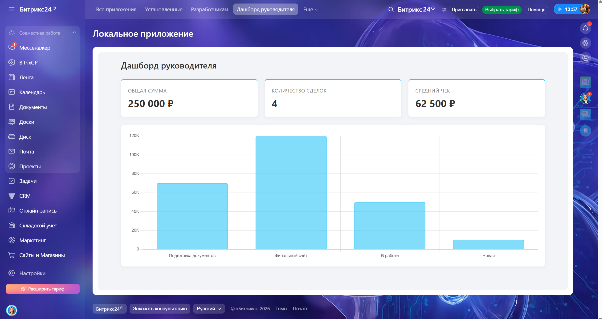

# Дашборд руководителя для Битрикс24 (Pet Project)

Статическое локальное приложение (Static Local App) для платформы Битрикс24, которое визуализирует ключевые метрики по сделкам в CRM.

<!-- Обязательно прикрепи тот скриншот, который ты присылал мне. Для этого загрузи картинку прямо в GitHub в интерфейсе создания README или в папку /assets -->

## 🚀 Функционал
- Агрегация данных по сделкам (общая сумма, количество, средний чек).
- Построение столбчатой диаграммы распределения сумм по стадиям сделок.
- Динамическая подгрузка названий стадий (fallback на ID, если стадия кастомная).
- Фильтрация данных по дате начала сделки (`BEGINDATE`): за всё время, за последние 30 дней, за текущий месяц.
- Пагинация запросов к REST API (сбор более 50 записей).

## 🛠 Стек и технологии
- **Frontend:** HTML5, CSS3 (Grid Layout, CSS Variables), Vanilla JS.
- **Библиотеки:** `BX24.js` (SDK для работы с порталом), `Chart.js` (визуализация данных).
- **API:** REST API Битрикс24 (`crm.deal.list`, `crm.status.list`).

## 🧠 Особенности реализации (Technical Highlights)
1. **Статическое локальное приложение:** Приложение не требует внешнего сервера, разворачивается внутри портала через ZIP-архив.
2. **Обработка ошибок и Edge-cases:** Использован `parseFloat` с fallback на `0` для защиты от пустых сумм в сделках.
3. **Пагинация:** Написан рекурсивный метод для обхода лимита REST API в 50 записей на один запрос.
4. **Бизнес-логика:** Фильтрация привязана к `BEGINDATE`, как к более релевантному бизнес-показателю, с учетом возможных пустых значений в CRM.

## 📦 Как развернуть
1. Скачайте файлы `index.html`, `style.css`, `app.js`.
2. Упакуйте их в ZIP-архив (файлы должны лежать в корне архива, без вложенных папок).
3. В Битрикс24 перейдите в раздел «Приложения» -> «Разработчикам» -> «Локальное приложение» -> «Статичное».
4. Загрузите ZIP-архив, укажите права доступа `CRM (crm)`.
5. Нажмите «Создать» и откройте приложение.